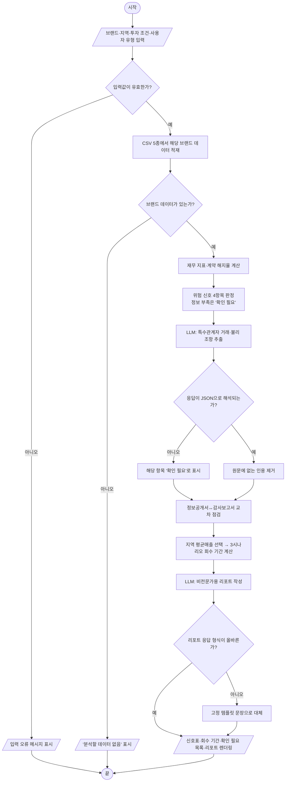

# 설계 문서 V1 — 프랜차이즈 본사 재무 건강검진

AI 오케스트레이션 스튜디오 · 제7주차 · 설계 문서 V1 (배점 10%)

| 항목 | 내용 |
|---|---|
| 팀명 | Decoders |
| 팀원 (역할) | 김리나 (저장소 관리자 · 데이터 적재 모듈)<br>오채윤 (회수 기간 시뮬레이션 모듈)<br>임채희 (LLM 문서 추출 · 교차 점검)<br>이혜원 (LLM 리포트 · 화면)<br>최영효 (재무·계약 신호 판정 모듈) |
| 가주제 한 줄 요약 | 공시 자료(감사보고서·정보공개서)를 해석해 예비 가맹점주에게 프랜차이즈 본사의 재무 위험 신호와 현실적인 원금 회수 기간(보수·평균·낙관)을 비전문가용 리포트로 보여 주는 '프랜차이즈 본사 재무 건강검진' |
| 저장소 | https://github.com/benebeau214/Team_Decoders |

**목차**
- [파트 1. 문제 정의서](#파트-1-문제-정의서-6요소)
- [파트 2. 모듈 분해도](#파트-2-모듈-분해도)
- [파트 3. Pseudocode / Flowchart](#파트-3-pseudocode--flowchart)
- [파트 4. 테스트 케이스 명세](#파트-4-테스트-케이스-명세)
- [파트 5. 캡스톤 가주제 제안서](#파트-5-캡스톤-가주제-제안서)
- [제출 전 체크리스트](#제출-전-체크리스트-강의노트-43절)
- [AI·데이터 보안 체크리스트](#ai데이터-보안-체크리스트-5주차-첨부-1호)
- [AI 사용 기록](#ai-사용-기록)

---

## 파트 1. 문제 정의서 (6요소)

| 요소 | 내용 |
|---|---|
| ① 배경과 문제 진술 | 퇴직금·대출로 창업 자금을 마련하는 재무 비전문가는 짧은 준비 기간에 큰돈을 걸지만, 본사의 감사보고서와 정보공개서는 DART·공정위에 공개되어 있어도 읽고 해석하기 어렵다. 그래서 계약 전에는 홍보자료만 보게 되고, 홍보자료의 원금 회수 기간은 보증금·권리금·대출 이자를 빼고 개설비만으로 계산되는 경우가 많아 실제보다 짧아 보인다. 감사보고서 주석과 정보공개서 기재가 서로 어긋나는 경우(예: 계열 금융사 거래가 있는데 정보공개서에는 대출 알선 '없음')도 점주가 스스로 찾기 어렵다.<br>**본사 리스크가 가맹점 피해로 이어진 사례**: 한 외식 프랜차이즈 본사가 정책자금을 연 3~6%로 빌려 대주주 일가의 대부업체를 거쳐 가맹점주에게 연 12~18%로 창업자금을 대출한 것으로 보도되었고, 공정위가 심의에 착수했다 ([뉴시스, 2026.05.10](https://mobile.newsis.com/view/NISX20260510_0003623161), [MTN, 2026.07.06](https://news.mtn.co.kr/news-detail/2026070611272488488)).<br>**이 서비스는 예비 점주가 계약 전에 본사의 재무 위험과 현실적인 회수 기간을 쉽게 확인하게 한다.** |
| ② 사용자 | **[1차] 계약 전 예비 가맹점주** (재무 비전문가, 비개발자): 브랜드 2~3곳을 비교하는 1~2주 동안 노트북 브라우저에서 브랜드별로 사용<br>**[2차] 계약 갱신·추가 출점을 앞둔 기존 가맹점주**: 같은 데이터로 최근 재무 변화 중심의 리포트를 제공. 성공 기준과 리포트 품질 점검은 1차 사용자 기준으로 하고, 2차 사용자용 리포트는 일정 여유가 있을 때 구현한다.<br>※ 은행·보증기관, 가치소비 소비자는 이번 학기 제외 |
| ③ 입력 | **사전 적재 CSV 5종** (외식 브랜드 10~20개, 모두 기업 단위 공개 데이터, 개인정보 없음, UTF-8/CP949)<br>• `hq_financials.csv`: 본사 재무 (브랜드·연도당 1행, 약 30~60행)<br>• `franchise_disclosure.csv`: 정보공개서 (브랜드·연도당 1행)<br>• `region_sales.csv`: 정보공개서 시도별 가맹점 평균매출 (브랜드·연도·시도당 1행)<br>• `audit_notes.csv`: 감사보고서 특수관계자 주석 발췌<br>• `disclosure_clauses.csv`: 정보공개서 계약 조항 발췌<br>**사용자 입력 7개**: 브랜드, 지역(시도), 보증금, 권리금, 대출금, 대출 금리(연 %), 사용자 유형(예비/기존)<br>(열 이름·타입은 구현 전 팀 표준 스키마로 확정) |
| ④ 출력 | 브랜드 1개를 선택하면 한 화면에 다음을 표시한다.<br>① **본사 신호표**: 부채비율·자본잠식·영업이익률·계약 해지율 4항목의 수준(정상/주의/위험/확인 필요)과 근거 한 줄<br>② **원금 회수 기간 표·차트**: 보수·평균·낙관 3시나리오의 월 순이익과 회수 기간(개월), 사용한 가정값(매출 계수·순이익률·평균매출 기준 지역). 회수 기간이 60개월을 넘으면 "장기 가정 의존, 불확실" 표시<br>③ **확인 필요 목록**: 정보공개서↔감사보고서 불일치, 점주에게 불리한 조항(원문 인용 포함)<br>④ **비전문가용 리포트**: 계약 전 확인 사항 중심, 기준연도 표시, "법률·투자 자문 아님" 문구 |
| ⑤ 성공 기준 | • **정확성**: 샘플 브랜드 5개의 지표·회수 기간이 엑셀 수기 계산과 일치 (오차 ±0.1 이내)<br>• **테스트**: 파트 4 명세 전부와 이후 추가 케이스 pytest 통과 (9~10주차)<br>• **환각 방지**: 추출된 조항·거래의 인용문 100%가 원문에 실제로 존재 (불일치 0건)<br>• **조항 추출 품질** (13주차 실제 LLM 연결 후): 표본 10개 브랜드 수동 라벨 대비 불리 조항 재현율 80% 이상<br>• **사용자 이해도**: 재무 비전공자 5명 중 4명 이상이 리포트를 읽고 해당 브랜드의 핵심 위험 신호 2개를 설명할 수 있음<br>• **안정성**: 불량 LLM 응답을 20% 주입하고 예외 입력 10종을 넣어도 앱 중단 0건, 실패 항목은 모두 '확인 필요'로 표시<br>• **속도**: 브랜드 선택 후 30초 이내 결과 표시 (LLM 호출 포함) |
| ⑥ 범위 | **[포함]** 3개 기능: ① 본사 재무·계약 신호 진단 ② 보수·평균·낙관 회수 기간 시뮬레이션 ③ 비전문가용 리포트. 사전 적재한 외식 브랜드 10~20개.<br>**[제외 — 이번 학기에 하지 않을 것]**<br>1) DART·공정위 자동 수집(크롤링·API 연동): 데이터는 팀이 정리한 CSV 사용<br>2) PDF·이미지 업로드와 OCR: 원문은 텍스트 발췌만 사용<br>3) 외식 외 업종, 외식 브랜드 20개 초과<br>4) 은행·보증기관·가치소비자용 리포트(확장 사용자)<br>5) 로그인·회원 관리·결과 저장<br>6) 점포 입지·상권 분석, 개별 점포 매출 예측<br>7) 가맹 여부 권유나 법적 유불리 최종 판정: '확인 필요 신호' 표시까지만 한다 (법률·투자 자문 아님을 화면에 명시)<br>8) 본사 비재무 리스크(공정위 제재 이력 등) 분석: 일정이 남으면 추가할 1순위 확장 후보 |

---

## 파트 2. 모듈 분해도

### (1) 시스템 수준 IPO

| Input (입력) | Processing (처리) | Output (출력) |
|---|---|---|
| • 브랜드·지역 선택<br>• 보증금·권리금·대출금·금리·사용자 유형<br>• 사전 적재 CSV 5종 | ① 입력·파일 검증<br>② 재무 지표 계산(부채비율·영업이익률·자본잠식)과 계약 해지율 계산<br>③ 임계값 비교로 위험 신호 판정<br>④ LLM(목): 주석·조항에서 특수관계자 거래·불리 조항 추출<br>⑤ 정보공개서↔감사보고서 교차 점검<br>⑥ 지역 평균매출 선택과 3시나리오 원금 회수 기간 계산<br>⑦ LLM(목): 비전문가용 리포트 문장 작성 | • 본사 신호표(4항목)<br>• 회수 기간 표·차트(3시나리오, 가정값·불확실 표시)<br>• 불일치·불리 조항 목록(원문 인용)<br>• 비전문가용 리포트(기준연도 표시) |

### (2) 모듈 트리 (시스템 → 모듈 → 함수)

```
franchise_checkup/                                        # 시스템
├── data_loader.py                                        # [모듈 1] 데이터 적재·입력 검증
│   ├── load_csv_table(filepath, required_cols)           # CSV → DataFrame (인코딩·쉼표·필수 열 처리)
│   ├── validate_user_input(raw)                          # 사용자 입력 범위 검사 → 정리된 dict
│   └── select_avg_sales(disc_row, region_rows, region)   # 선택 지역의 평균매출, 없으면 전국 평균
├── signals.py                                            # [모듈 2] 재무·계약 신호 계산과 판정
│   ├── calc_financial_ratios(fin_row)                    # 부채비율·영업이익률·자본잠식 상태
│   ├── calc_termination_rate(disc_row)                   # 계약 해지·종료 비율
│   ├── judge_risk_signals(ratios, rate, thresholds)      # ★ 4항목 위험 수준 판정
│   └── cross_check_documents(deals, disc_row)            # 정보공개서↔감사보고서 불일치 탐지
├── payback.py                                            # [모듈 3] 원금 회수 기간 시뮬레이션
│   ├── calc_payback_months(investment, profit)           # 회수 기간(개월), 손실이면 NaN
│   └── simulate_payback(disc_row, user_input, scenarios) # ★ 3시나리오 표
├── llm_tasks.py                                          # [모듈 4] LLM 위임 영역
│   ├── extract_related_party_deals(note_text, llm_call)  # ※ 목(mock)
│   ├── extract_unfavorable_clauses(clause_text, llm_call)# ★ ※ 목(mock)
│   └── write_report(signals, payback_df, flags, user_type, llm_call)  # ※ 목(mock)
└── app.py                                                # [모듈 5] 표시 (Streamlit, 11~12주차)
    └── main()                                            # 입력 → 위 함수 호출 → 화면 렌더링
```
모듈 5개, 함수 12개 (★ = 파트 3·4의 핵심 함수)

### (3) 함수 목록

| 함수명 | 책임 (한 문장) | 입력 | 출력 | LLM 목 |
|---|---|---|---|---|
| load_csv_table | CSV 1개를 필수 열이 보장된 DataFrame으로 불러온다 | filepath, required_cols | DataFrame | 아니오 |
| validate_user_input | 사용자 입력 dict의 값 범위를 검사해 정리된 dict로 돌려준다 | raw: dict | dict | 아니오 |
| select_avg_sales | 선택한 지역의 가맹점 평균매출을 고르고, 없으면 전국 평균과 그 기준을 돌려준다 | disc_row, region_rows, region | dict {value, basis} | 아니오 |
| calc_financial_ratios | 본사 재무 1행에서 부채비율·영업이익률·자본잠식 상태를 계산한다 | fin_row: dict | dict (3개 지표) | 아니오 |
| calc_termination_rate | 정보공개서 1행에서 연초 가맹점 수 대비 계약 해지·종료 비율(%)을 계산한다 | disc_row: dict | float \| None | 아니오 |
| judge_risk_signals ★ | 지표를 임계값과 비교해 4개 항목의 위험 수준을 판정한다 | ratios, termination_rate, thresholds | list[dict] (4항목) | 아니오 |
| cross_check_documents | 감사보고서 주석의 특수관계자 거래와 정보공개서 기재가 어긋나는 곳을 찾는다 | deals, disc_row | list[dict] {issue, evidence} | 아니오 |
| calc_payback_months | 총투자금과 월 순이익으로 원금 회수 기간(개월)을 계산한다 | investment, profit | float (손실이면 NaN) | 아니오 |
| simulate_payback ★ | 보수·평균·낙관 시나리오별 월 순이익과 회수 기간 표를 만든다 | disc_row, user_input, scenarios | DataFrame | 아니오 |
| extract_related_party_deals | 감사보고서 주석 텍스트에서 특수관계자 거래 항목을 JSON으로 추출한다 | note_text, llm_call | dict {status, items} | 예 |
| extract_unfavorable_clauses ★ | 정보공개서 조항 텍스트에서 점주에게 불리한 조항을 유형과 원문 인용으로 추출한다 | clause_text, llm_call | dict {status, items, dropped} | 예 |
| write_report | 신호·회수 기간·불일치 결과를 사용자 유형에 맞는 비전문가용 문장으로 작성한다 | signals, payback_df, flags, user_type, llm_call | dict {summary, checklist} | 예 |
| main | 사용자 입력을 받아 위 함수들을 순서대로 호출하고 결과 화면을 그린다 | (Streamlit 입력 위젯) | (화면 출력) | 아니오 |

### (4) 설계 원칙
- **호출 방향은 한쪽**: `app → llm_tasks / payback / signals → data_loader`. 하위 모듈은 화면(app)을 모르고, 전역 변수 없이 매개변수로 값을 받고 RETURN으로 돌려준다.
- **계산은 파이썬, LLM은 추출과 문장 작성만**: 지표·회수 기간·위험 판정은 규칙과 계산으로 처리하고, LLM에는 숫자를 만들게 하지 않는다.
- **LLM 목(mock) 처리 계획**: LLM 함수 3개는 `llm_call`을 매개변수로 받는다. 13주차 전까지는 고정 JSON을 돌려주는 목 함수를 넘기고, 13주차에는 실제 API 호출 함수를 넘긴다. **LLM 함수 본체와 호출하는 쪽 코드는 바뀌지 않는다.** 테스트에서는 불량 응답을 돌려주는 목 함수를 넘겨 예외 흐름을 검증한다.
- **정보 부족은 '정상'이 아니라 '확인 필요'**: 값이 없거나 LLM 응답을 해석하지 못하면 위험이 없다고 간주하지 않는다.

---

## 파트 3. Pseudocode / Flowchart

### (1) 핵심 함수 1 — simulate_payback

```python
def simulate_payback(disc_row: dict, user_input: dict, scenarios: dict) -> pd.DataFrame:
    """보수·평균·낙관 시나리오별 월 순이익과 원금 회수 기간 표를 만든다.

    Args:
        disc_row: {startup_cost, avg_annual_sales} — avg_annual_sales는 select_avg_sales가 고른 값
        user_input: {deposit, key_money, loan_amount, loan_rate(연 %)}
        scenarios: {시나리오명: {sales_factor, margin}}
    Returns:
        열 [scenario, monthly_net_profit, payback_months, uncertain]
        월 순이익이 0 이하이면 payback_months는 NaN(회수 불가).
        uncertain은 payback_months가 60개월을 넘거나 NaN이면 True.
    Raises:
        ValueError: 평균매출·창업비용 누락, 음수 입력, 빈 시나리오.
    """
    ...
```

```
함수 simulate_payback — 입력: disc_row, user_input, scenarios
                        출력: DataFrame [scenario, monthly_net_profit, payback_months, uncertain]

    IF disc_row의 avg_annual_sales가 None이거나 0 이하이면
        ValueError("평균매출 없음")를 발생시키고 종료한다
    IF disc_row의 startup_cost가 None이거나 0 미만이면
        ValueError("창업비용 없음")를 발생시키고 종료한다
    IF deposit, key_money, loan_amount, loan_rate 중 하나라도 0 미만이면
        ValueError("음수 입력")를 발생시키고 종료한다
    IF scenarios가 비어 있으면
        ValueError("시나리오 없음")를 발생시키고 종료한다
    total_investment = startup_cost + deposit + key_money
    monthly_interest = loan_amount × loan_rate ÷ 100 ÷ 12
    monthly_sales = avg_annual_sales ÷ 12
    rows = 빈 리스트
    FOR scenarios의 각 (name, params) 반복
        monthly_net_profit = monthly_sales × params.sales_factor × params.margin − monthly_interest
        payback_months = calc_payback_months(total_investment, monthly_net_profit)   # 월 순이익 ≤ 0이면 NaN
        uncertain = payback_months가 NaN이거나 60을 넘는가
        rows에 {scenario: name, monthly_net_profit, payback_months, uncertain}를 추가한다
    RETURN rows를 DataFrame으로 만들고 숫자 열을 소수 첫째 자리까지 반올림한 결과
```

### (2) 핵심 함수 2 — judge_risk_signals

```python
def judge_risk_signals(ratios: dict, termination_rate: float | None,
                       thresholds: dict) -> list[dict]:
    """재무 지표와 계약 해지율을 임계값과 비교해 4개 항목의 위험 수준을 판정한다.

    Args:
        ratios: {debt_ratio, op_margin, capital_status("정상"|"부분잠식"|"완전잠식")}
        termination_rate: 계약 해지율(%), 정보가 없으면 None
        thresholds: {debt_warn, debt_danger, term_warn, term_danger}
                    초기값 debt 200/400, term 10/20 (팀이 근거와 함께 확정)
    Returns:
        [{item, level, value, reason}] 항상 4개, 순서 고정.
        level ∈ {"정상", "주의", "위험", "확인 필요"}
    Raises:
        ValueError: ratios가 dict가 아니거나 필수 키가 없을 때.
    """
    ...
```

```
함수 judge_risk_signals — 입력: ratios, termination_rate, thresholds
                          출력: 신호 4개 리스트 [{item, level, value, reason}]

    IF ratios가 dict가 아니거나 debt_ratio·op_margin·capital_status 키 중 하나라도 없으면
        ValueError("필수 지표 누락")를 발생시키고 종료한다
    signals = 빈 리스트
    # 1) 부채비율
    IF debt_ratio가 None이면 level = "확인 필요"
    ELSE IF debt_ratio ≥ thresholds.debt_danger이면 level = "위험"
    ELSE IF debt_ratio ≥ thresholds.debt_warn이면 level = "주의"
    ELSE level = "정상"
    signals에 {item: "부채비율", level, value, reason(고정 문장 템플릿)}를 추가한다
    # 2) 자본잠식
    IF capital_status가 "완전잠식"이면 level = "위험"
    ELSE IF capital_status가 "부분잠식"이면 level = "주의"
    ELSE IF capital_status가 "정상"이면 level = "정상"
    ELSE level = "확인 필요"
    signals에 {item: "자본잠식", level, value, reason}를 추가한다
    # 3) 영업이익률
    IF op_margin이 None이면 level = "확인 필요"
    ELSE IF op_margin < 0이면 level = "주의"            # 영업손실
    ELSE level = "정상"
    signals에 {item: "영업이익률", level, value, reason}를 추가한다
    # 4) 계약 해지율
    IF termination_rate가 None이면 level = "확인 필요"
    ELSE IF termination_rate ≥ thresholds.term_danger이면 level = "위험"
    ELSE IF termination_rate ≥ thresholds.term_warn이면 level = "주의"
    ELSE level = "정상"
    signals에 {item: "계약 해지율", level, value, reason}를 추가한다
    RETURN signals          # 항상 4개, 정보 부족은 '정상'이 아니라 '확인 필요'
```

### (3) 핵심 함수 3 — extract_unfavorable_clauses (LLM 의존, 목 처리)

```python
def extract_unfavorable_clauses(clause_text: str,
                                llm_call: Callable[[str], str]) -> dict:
    """정보공개서 조항 텍스트에서 점주에게 불리한 조항을 유형과 원문 인용으로 추출한다.

    Args:
        clause_text: 정보공개서 계약 조항 발췌 원문.
        llm_call: 프롬프트 문자열을 받아 응답 문자열을 돌려주는 함수.
                  13주차 전에는 목(mock) 함수, 이후에는 실제 API 호출 함수.
    Returns:
        {"status": "ok" | "empty" | "parse_error",
         "items": [{"type": 아래 6개 중 하나, "quote": 원문 인용, "reason": 한 문장}],
         "dropped": 원문에 없는 인용이라 제외한 항목 수}
        type ∈ {"필수품목·구매 강제", "위약금·손해배상", "계약 해지·갱신",
                "영업지역", "광고·판촉비 분담", "기타"}
    """
    ...
```

```
함수 extract_unfavorable_clauses — 입력: 조항 원문(문자열), llm_call(함수)
                                   출력: {status, items, dropped}

    IF clause_text가 문자열이 아니거나, 비어 있거나, 공백뿐이면
        RETURN {status: "empty", items: [], dropped: 0}
    추출 요청 프롬프트를 만든다
        (불리 조항 유형 후보 6개, 각 항목은 원문을 그대로 인용, 출력은 JSON만 허용)
    응답 = llm_call(프롬프트)                          ※ 현 단계는 목 함수
    응답에서 앞뒤 공백과 코드펜스(```)를 제거한다
    IF 응답이 JSON으로 해석되지 않거나 items 키가 리스트가 아니면
        RETURN {status: "parse_error", items: [], dropped: 0}
        # 빈 결과(불리 조항 없음)로 반환하면 '안전'으로 오인되므로 parse_error로 구분한다
    items = 빈 리스트, dropped = 0
    FOR 응답의 각 항목 반복
        IF 항목의 quote가 clause_text 안에 그대로 들어 있지 않으면
            dropped를 1 늘리고 다음 항목으로 넘어간다      # 환각 인용 제거
        IF 항목의 type이 후보 6개에 없으면
            type을 "기타"로 바꾼다
        items에 {type, quote, reason}을 추가한다
    RETURN {status: "ok", items, dropped}
```

### (4) 전체 파이프라인 상위 Flowchart

단일 시작·단일 끝, 모든 판단의 두 갈래가 다시 합류하는 구조다. (GitHub에서 Mermaid 다이어그램으로 표시된다.)



---

## 파트 4. 테스트 케이스 명세

- 결정적 계산 함수(`simulate_payback`, `judge_risk_signals`)는 **값**으로 검증한다.
- LLM 의존 함수(`extract_unfavorable_clauses`)는 출력이 비결정적이므로 **형식 계약**(키 존재, 허용값, 인용문이 원문에 존재)으로 검증한다. 목 함수(`llm_call`)를 바꿔 끼워 불량 응답을 재현한다.

| ID | 대상 함수 | 범주 | 입력 | 기대 출력 / 동작 |
|---|---|---|---|---|
| T01 | simulate_payback | 정상 | disc_row{startup_cost:10000, avg_annual_sales:24000}, user_input{deposit:2000, key_money:3000, loan_amount:0, loan_rate:0}, scenarios{보수:(0.8, 0.05), 평균:(1.0, 0.10), 낙관:(1.2, 0.15)} | 총투자금 15,000. 월 순이익 80 / 200 / 360, payback_months 187.5 / 75.0 / 41.7, uncertain True / True / False |
| T02 | simulate_payback | 정상 | T01과 같고 loan_amount:12000, loan_rate:5.0 (월 이자 50) | 월 순이익 30 / 150 / 310, payback_months 500.0 / 100.0 / 48.4, uncertain True / True / False |
| T03 | simulate_payback | 경계 | T01과 같고 loan_amount:40000, loan_rate:6.0 (월 이자 200) | 평균 월 순이익 정확히 0 → payback_months NaN, uncertain True. 보수도 NaN, 낙관 93.8. ZeroDivisionError 없음 |
| T04 | simulate_payback | 예외 | disc_row의 avg_annual_sales = None | ValueError 발생 |
| T05 | simulate_payback | 예외 | user_input의 deposit = −1000 | ValueError 발생 |
| T06 | judge_risk_signals | 정상 | ratios{debt_ratio:450.0, op_margin:−2.0, capital_status:"완전잠식"}, termination_rate:25.0, thresholds{debt_warn:200, debt_danger:400, term_warn:10, term_danger:20} | 부채비율 위험, 자본잠식 위험, 영업이익률 주의, 계약 해지율 위험 (항목 4개, 순서 고정) |
| T07 | judge_risk_signals | 정상 | ratios{debt_ratio:250.0, op_margin:3.0, capital_status:"부분잠식"}, termination_rate:12.0, 임계값은 T06과 같음 | 부채비율 주의, 자본잠식 주의, 영업이익률 정상, 계약 해지율 주의 |
| T08 | judge_risk_signals | 경계 | ratios{debt_ratio:200.0, op_margin:5.0, capital_status:"정상"}, termination_rate:3.0, 임계값은 T06과 같음 | 부채비율 정확히 200.0 → "주의"(임계값 이상이면 해당 수준), 나머지 "정상" |
| T09 | judge_risk_signals | 예외 | ratios{debt_ratio:None, op_margin:None, capital_status:"NA"}, termination_rate:None | 예외 없이 4개 항목 모두 "확인 필요" ('정상'으로 대체 금지) |
| T10 | judge_risk_signals | 예외 | ratios = {} | ValueError 발생 |
| T11 | extract_unfavorable_clauses | 정상 | "가맹점사업자는 가맹본부가 지정한 업체로부터 원재료 전량을 구매하여야 한다." + 해당 문장을 인용한 정상 JSON을 돌려주는 목 함수 | status "ok", items 1개 이상, 각 type ∈ 허용 6개, 각 quote가 입력 원문에 포함 |
| T12 | extract_unfavorable_clauses | 정상 | "계약 기간 중 해지 시 가맹점사업자는 위약금으로 가맹비의 3배를 지급한다." + 정상 JSON 목 함수 | status "ok", type ∈ 허용 6개, quote가 입력 원문에 포함 |
| T13 | extract_unfavorable_clauses | 경계 | "가맹본부는 연 2회 위생 교육을 무상으로 제공한다." + `{"items": []}`를 돌려주는 목 함수 | status "ok", items [] (불리 조항 없음도 정상 응답) |
| T14 | extract_unfavorable_clauses | 예외 | "" (빈 문자열) | {status: "empty", items: [], dropped: 0}. llm_call을 호출하지 않음 |
| T15 | extract_unfavorable_clauses | 예외 (LLM 오응답) | 정상 조항 + 잘린 JSON(`{"items": [{"type": "위약`)을 돌려주는 목 함수 | status "parse_error", items [] — 예외로 앱이 멈추지 않음 |
| T16 | extract_unfavorable_clauses | 예외 (환각 인용) | 정상 조항 + 원문에 없는 문장을 quote로 넣은 JSON을 돌려주는 목 함수 | 해당 항목 제외, dropped = 1 |

함수별 범주: `simulate_payback` 정상 2·경계 1·예외 2 / `judge_risk_signals` 정상 2·경계 1·예외 2 / `extract_unfavorable_clauses` 정상 2·경계 1·예외 3

---

## 파트 5. 캡스톤 가주제 제안서

### (1) 가주제 한 줄 요약
공시 자료를 해석해 예비 가맹점주에게 프랜차이즈 본사의 재무 위험 신호와 현실적인 원금 회수 기간을 비전문가용 리포트로 보여 주는 '프랜차이즈 본사 재무 건강검진'.

### (2) 6주차 주제 카탈로그와의 관계: **변형**
카탈로그의 **데이터 분석·리포트형**("CSV를 업로드하면 요약 통계와 함께 인사이트 리포트를 생성", LLM은 pandas 집계 결과를 해석)을 바탕으로, 5주차 개인 아이디어 노트(프랜차이즈 본사 재무 진단)를 결합해 변형했다. 사용자가 CSV를 올리는 대신 팀이 공시 자료를 미리 정리해 두고, LLM의 역할에 **공시 원문에서 조항·거래를 추출**하는 일을 더했다.

### (3) LLM 활용 지점
| LLM이 맡는 일 | LLM 없이 처리하는 일 |
|---|---|
| ① 감사보고서 주석에서 특수관계자 거래 추출 (`extract_related_party_deals`)<br>② 정보공개서 조항에서 불리한 조항 추출 (`extract_unfavorable_clauses`)<br>③ 계산 결과를 비전문가용 문장으로 작성 (`write_report`) | 재무 지표·해지율 계산, 위험 신호 판정, 교차 점검, 회수 기간 계산 (모두 파이썬 규칙·계산) |

### (4) 무료 챗봇 UI 검증 계획 (13주차 API 연결 전)
- **대상**: 불리 조항 추출 프롬프트(가장 판단이 어려운 LLM 작업)
- **방법**: 팀이 정리한 실제 정보공개서 조항 발췌 5건을 무료 챗봇 웹 UI에서 Zero-shot·Few-shot 두 방식으로 실행. 매번 새 대화창에서 실행하고 화면을 캡처한다.
- **기록할 지표**: JSON 형식 준수율, 인용문이 원문에 그대로 있는 비율, 팀 수동 라벨과의 일치 여부
- **활용**: 결과가 좋은 프롬프트를 13주차 `llm_call`의 기본 프롬프트로 확정한다. 6주차 실험 결과에 따라 경계 사례를 담은 Few-shot을 기본으로 시작한다.
- **보안**: 공시 원문은 기업 단위 공개 자료이지만, 특수관계인 개인 실명이 포함된 문장은 마스킹한 뒤 입력한다(5주차 PII 원칙).

### (5) 팀원 역할 분담 (초안)
| 팀원 | 담당 모듈·함수 | 주요 산출물 |
|---|---|---|
| 김리나 | 저장소 관리, `data_loader.py` (load_csv_table, validate_user_input, select_avg_sales) | 표준 CSV 스키마, 데이터 적재·검증 |
| 오채윤 | `payback.py` (calc_payback_months, simulate_payback) | 회수 기간 시뮬레이션, T01~T05 |
| 임채희 | `llm_tasks.py` 추출 함수 2개, `cross_check_documents` | 추출 프롬프트, 교차 점검, T11~T16, 챗봇 UI 검증 |
| 이혜원 | `llm_tasks.py` write_report, `app.py` | 리포트 문장, Streamlit 화면, 이해도 평가 진행 |
| 최영효 | `signals.py` (calc_financial_ratios, calc_termination_rate, judge_risk_signals) | 위험 신호 판정, 임계값 근거, T06~T10 |

### (6) 상호 리뷰 반영 내역

1조로부터 상호 리뷰 피드백을 받았고, 이를 바탕으로 반영 내역을 정리했다.

**체크리스트 결과 요약**: 1~6번 문항 모두 "예". 7번(구현 가능 범위)은 "DART·공정위 실시간 수집을 제외하고 자체 구축 CSV로 범위를 제한해 한 학기 내 구현 가능"으로 평가받았다.

| No | 받은 의견 | 반영/기각 | 사유 | 조치 (변경 위치) |
|---|---|---|---|---|
| 1 | 1~10년 이상의 미래 시장 환경을 단순한 데이터로 분석하기 어렵다 | 부분 반영 | 본 서비스는 미래 시장을 예측하지 않고, 공개 자료와 사용자 조건에 따른 가정 기반 시나리오를 보여 준다. 회수 기간 표에 사용한 가정값을 이미 함께 표시하고, 투자 자문이 아님을 화면에 명시한다(제외 7). 다만 회수 기간이 길수록 가정의 영향이 커진다는 지적은 타당하다. | 파트 1 ④ 출력 ②, 파트 3 simulate_payback: 60개월 초과 시 "장기 가정 의존, 불확실" 표시(uncertain 열) |
| 2 | 기존 점주와 예비 점주로 나누지 말고 예비 가맹점주 단일 타깃에 집중하라 | 부분 반영 | 두 사용자 유형은 같은 데이터와 계산을 쓰고 리포트 문장만 달라 기능 부담은 크지 않다. 다만 리포트 품질에 집중해야 한다는 취지는 타당하다. | 파트 1 ② 사용자: 예비 점주를 1차 대상으로 명시, 성공 기준과 품질 점검은 1차 대상 기준. 기존 점주용 리포트는 2순위 |
| 3 | 성공 기준이 모두 기술 지표라 사용자 관점 기준이 없다 | 반영 | 서비스 목적이 "비전문가가 쉽게 확인"하는 것이므로 이해도를 측정하는 기준이 있어야 목적 달성 여부를 판정할 수 있다. | 파트 1 ⑤ 성공 기준: "재무 비전공자 5명 중 4명 이상이 핵심 위험 신호 2개를 설명" 추가 |
| 4 | 점포 입지·상권, 개별 점포 매출 예측이 빠져 모델이 단순화되고 왜곡될 수 있다 | 부분 반영 | 입지·상권 분석과 개별 점포 매출 예측은 별도 데이터 수집과 모델링이 필요해 제외 목록(6)에 두었다. 다만 전국 평균매출만 쓰면 지역 차이가 무시된다는 점은 공개 자료 안에서 보완할 수 있다. | 파트 1 ③ 입력: 지역(시도) 선택과 `region_sales.csv` 추가. 파트 2: `select_avg_sales` 추가 (없으면 전국 평균을 쓰고 그 사실을 표시) |
| 5 | 본사의 재무 리스크가 가맹점 리스크로 이어진다는 논리에 근거가 더 필요하다 | 반영 | 서비스의 핵심 전제인데, 기존 문서는 근거를 `team_brainstorm.md` 참조로만 두었다. | 파트 1 ① 배경: 본사 대출 구조가 가맹점주 피해로 이어진 보도 사례와 출처를 본문에 추가 |
| 6 | 가맹점주 본인의 조건과 실제 생존·폐점을 고려하라 | 이미 반영됨 | 점주 본인 조건(보증금·권리금·대출금·금리)은 사용자 입력으로 받고, 폐점은 정보공개서의 계약 해지·종료 건수로 해지율을 계산해 신호표에 표시한다. | 변경 없음 (파트 1 ③·④, `calc_termination_rate`) |
| 7 | 점포 운영비를 고려하라 | 부분 반영 | 브랜드별 실제 운영비는 공개되지 않아, 시나리오별 매출 계수와 순이익률(sales_factor, margin)을 가정값으로 쓰고 있다. 이 가정의 근거를 분명히 할 필요가 있다. | 시나리오 순이익률의 기본값을 업종 평균 영업이익률(공공 통계)에서 정하고, 출처를 화면에 표시 |
| 8 | 입지, 본사의 비재무 리스크 등 외부 데이터를 활용하라 | 기각 (이번 학기) | 입지는 4번과 같은 이유로 제외한다. 비재무 리스크(공정위 제재 이력 등)는 의미가 있지만, 데이터 정리와 판정 기준 설계가 추가로 필요해 MVP 범위를 넘는다. | 파트 1 ⑥ 제외 8) 추가, 1순위 확장 후보로 표기 |

**정리**: 받은 의견 8건 중 반영 2건, 부분 반영 4건, 이미 반영 1건, 기각 1건. 범위를 넓히자는 의견(입지·상권, 외부 데이터)은 제외 목록을 유지하되 공개 자료로 가능한 보완(시도별 평균매출, 이익률 근거 명시)을 적용했고, 목적을 명확히 하는 의견(이해도 기준, 근거 보강)은 반영했다.

---

## 제출 전 체크리스트 (강의노트 4.3절)

| # | 확인 항목 | 확인 | 위치 |
|---|---|---|---|
| 1 | 성공 기준이 숫자 또는 판정 가능한 조건으로 서술되었다 | ☑ | 파트 1 ⑤ |
| 2 | '이번 학기에 하지 않을 것' 목록이 3개 이상 있다 | ☑ | 파트 1 ⑥ (8개) |
| 3 | 모든 함수에 한 문장 책임 설명이 붙어 있다 | ☑ | 파트 2 (3) 함수 목록 |
| 4 | LLM 의존 함수가 표시되고 목(mock) 대체 계획이 있다 | ☑ | 파트 2 (3) "LLM 목" 열, (4) 설계 원칙 |
| 5 | Pseudocode 3개 모두에 예외 흐름이 포함되어 있다 | ☑ | 파트 3 (1)~(3) |
| 6 | Flowchart의 모든 마름모에서 두 갈래가 모두 이어진다 | ☑ | 파트 3 (4) |
| 7 | 테스트 명세에 함수당 정상 2·경계 1·예외 1 이상이 있다 | ☑ | 파트 4 (T01~T16) |
| 8 | 상호 리뷰 반영 내역(반영/기각 + 사유)이 기록되어 있다 | ☑ | 파트 5 (6) |
| 9 | 팀 GitHub 저장소에 커밋되었고 링크가 LMS에 제출되었다 | ☐ | 제출 시 확인 |

## AI·데이터 보안 체크리스트 (5주차 첨부 1호)

| 번호 | 점검 항목 | 확인 | 비고 |
|---|---|---|---|
| S1 | 제출물에 실존 인물의 실명·전화번호·이메일 등 PII가 포함되지 않았다 | ☑ 예 | 기업 단위 공개 자료만 사용. 특수관계인 실명은 관계 유형으로만 표기 |
| S2 | 외부 AI(챗봇·API)에 기업 기밀·타인 코드·PII를 입력하지 않았다 | ☑ 예 | 공개 공시 자료만 입력, 개인 실명 포함 문장은 마스킹 후 입력 |
| S3 | 외부 데이터 사용 시 출처·라이선스를 확인하고 PII 열을 비식별 처리했다 | ☑ 예 | DART·공정위 공개 자료, 출처를 리포트에 표시 |
| S4 | API 키·비밀번호가 소스코드에 하드코딩되어 있지 않다 | 해당 없음 | 설계 단계. 구현 시 `.env`로 관리 예정 |
| S5 | .env 파일이 .gitignore에 등록되어 있고 추적되지 않는다 | 해당 없음 | 구현 시작 시 `.gitignore`에 `.env` 등록 예정 |
| S6 | 커밋 히스토리에 키가 노출된 적이 없다 | ☑ 예 | |
| S7 | 키·비밀 값을 print/log/스크린샷으로 전체 출력하지 않았다 | ☑ 예 | |
| S8 | AI 사용 내역(프롬프트·채택·수정)을 기록·첨부했다 | ☑ 예 | 문서 하단 "AI 사용 기록" |
| S9 | (LLM 기능 포함 시) 사용자 입력 검증과 출력 검증을 적용했다 | ☑ 예 (설계) | `validate_user_input`, JSON 파싱 실패 처리, 허용값 검증, 인용문 원문 대조 |
| S10 | (LLM 기능 포함 시) 시스템 프롬프트에 비밀 정보를 포함하지 않았다 | ☑ 예 (설계) | 프롬프트에는 분류 기준과 출력 형식만 포함 |

---

## AI 사용 기록

| 항목 | 내용 |
|---|---|
| 사용 도구 | Claude AI, ChatGPT |
| 사용 범위 | 설계 문서 작성: 팀이 정한 내용을 표와 문장으로 정리, Pseudocode·테스트 케이스 명세 초안 작성, 테스트 기대값 검산, 문장 다듬기 |
| 결정 방식 | 가주제 선정, 사용자·범위(포함/제외) 설정, 성공 기준, 모듈 분해 방향, 상호 리뷰 의견의 반영/기각, 역할 분담은 **팀원별 토의를 통해 결정하고 판단**했다. AI가 작성한 초안은 팀이 검토한 뒤 수정·채택했다. |
| 입력 자료 | 팀이 작성한 브레인스토밍 노트와 설계 초안, 공개 공시 자료에 관한 설명. 개인정보(PII)와 API 키는 입력하지 않았다. |

