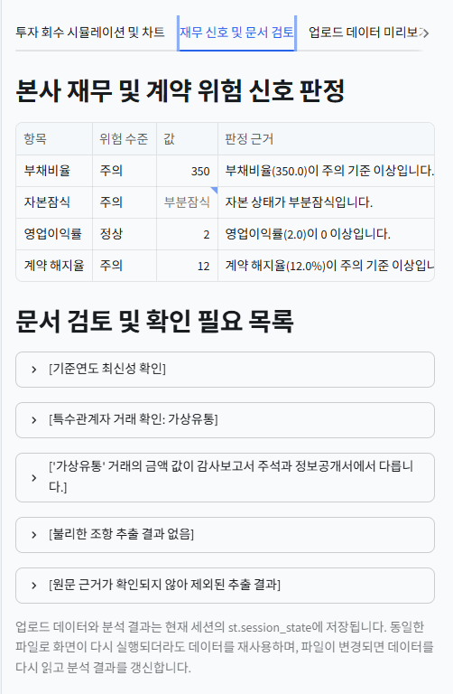
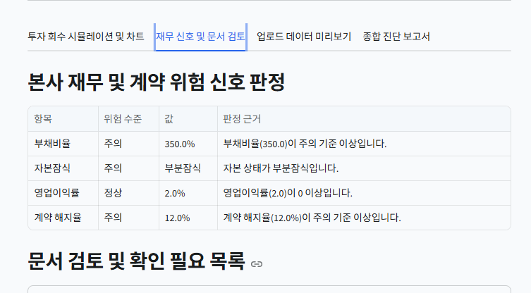
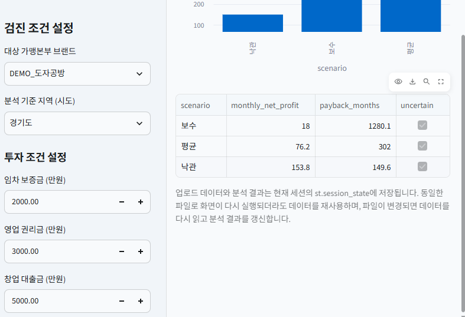
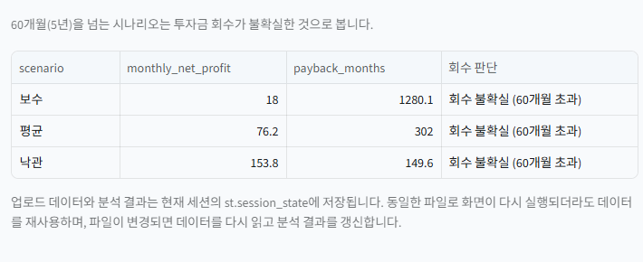
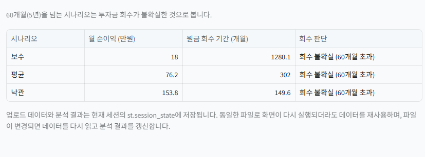
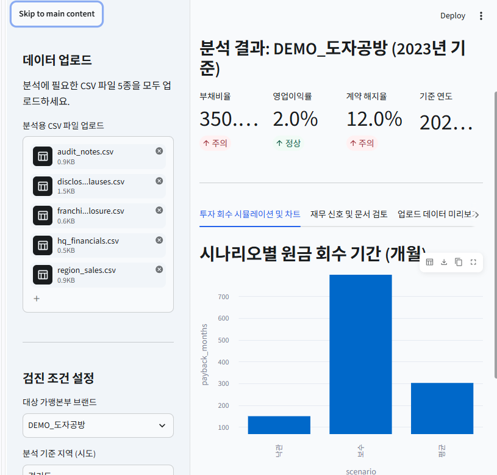
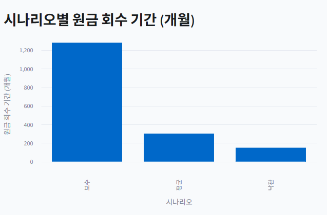
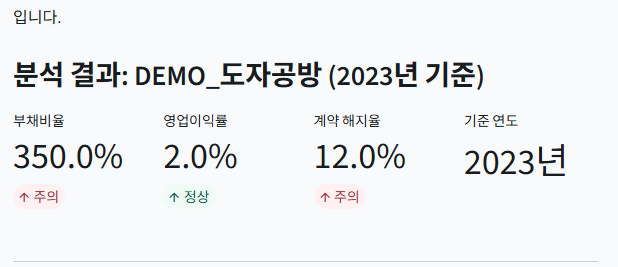
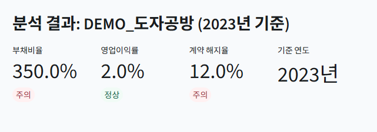

# 12주차 교차 테스트 피드백 반영 기록

4조로부터 받은 피드백 반영 기록을 정리한 문서입니다.

기입한 피드백 ID의 영문자는 유형을 나타냅니다. **B**는 버그, **U**는 사용성, **S**는 제안입니다. 뒤의 숫자는 피드백을 받은 순서 번호입니다.

반영한 피드백의 설명에 사용한 수정 전후 화면 캡처는 `docs/screenshots/`에 저장한 뒤 각 항목의 경로 예시를 참고해 연결합니다.

## 1. 반영한 피드백 (7건)

### B1. 판정 표 '값' 열에 "정상" 문자열이 섞여 "not a number" 오류 발생

- **담당자**: 영효

- **받은 피드백 원문**
    > 정상이라는 값이 int가 아니라고 뜨는 오류 메시지 (마이너한 버그)

- **수정 전 화면 또는 동작**

    

    '재무 신호 및 문서 검토' 탭 판정 표의 '값' 열에서 자본잠식 행의 "부분잠식"이 흐리게 표시되고, 셀에 "The value cannot be interpreted as a number." 오류 표시가 나타남. 비율 값(350, 2, 12)에는 % 단위도 없음.

- **수정 내용과 근거**
    - 수정 내용 — `format_signal_value()`를 추가해 비율 항목은 `format_percent`로 "350.0%" 형식, 자본잠식은 상태 문자열("정상"·"부분잠식" 등, 값이 없으면 "확인 필요")로 바꾼 표시용 목록을 만들고, '값' 열 타입을 `NumberColumn`에서 `TextColumn`으로 변경
    - 근거 — '값' 열에는 비율 숫자와 자본잠식 상태 문자열이 함께 들어가는데 열을 숫자 타입으로 지정해 문자열을 해석하지 못한 것이 원인. 원본 `signals`는 상단 metric에서도 쓰므로 그대로 두고 표시용 값만 변환함. % 단위가 붙어 U8(단위 누락)도 일부 해소됨

- **수정 후 화면**

    

    '값' 열이 `350.0%` / `부분잠식` / `2.0%` / `12.0%`로 표시되고 오류 표시가 사라짐.

- **해당 수정의 커밋 해시**: `3170f84`

---

### B2. 보수 시나리오의 `payback_months` 값 1280.1이 맞는지 확인

- **담당자**: 영효

- **받은 피드백 원문**
    > 가상 데이터에 따른 결과일 수 있으나, ‘시나리오별 원금 회수 기간(개월)ʼ 탭의 분석이 정상적으로 이루어졌는지 확인 필요. 예를 들어 현재 보수 시나리오의 payback_months가 1280.1로 표시되어 있는데, 해당 수치가 실제 개월 단위로 올바르게 계산된 것인지 확인이 필요해 보임.

- **수정 전 화면 또는 동작**

    

    표에 보수 시나리오 회수 기간이 1280.1로만 표시되고, `uncertain` 열은 체크박스뿐이라 이 숫자가 무엇을 뜻하는지 알 수 없음.

- **수정 내용과 근거**

    - 수정 내용 — 계산식은 그대로 두고 표시를 개선함. 체크박스뿐인 `uncertain` 열 대신 "회수 판단" 열을 추가해 "회수 불확실 (60개월 초과)" / "60개월 이내" / "회수 불가 (월 순이익 0 이하)"로 표시하고, 차트 아래에 "60개월(5년)을 넘는 시나리오는 투자금 회수가 불확실한 것으로 봅니다." 안내 문구를 추가. 기준값 60은 `payback.py`의 `UNCERTAIN_MONTHS`를 그대로 사용
    - 근거 — 직접 계산해 보니 값이 정확함(단위 만원). 총 투자금 23,000(창업비용 18,000 + 보증금 2,000 + 권리금 3,000), 월 매출 970(경기도 연평균 11,640 ÷ 12), 월 대출 이자 20.8(5,000 × 5% ÷ 12)일 때 보수 시나리오 월 순이익은 970 × 0.8 × 0.05 − 20.8 = 18.0, 회수 기간은 23,000 ÷ 18.0 = 1280.1개월. 즉 계산 오류가 아니라 '사실상 회수 불가'라는 의미를 알려주지 않는 표시 문제였음. 데모 데이터는 세 시나리오 모두 60개월을 넘기 때문에 60개월 초과 시나리오를 차트에서 빼면 차트가 비게 되어, 차트는 유지하고 안내 문구를 추가하는 방식을 선택함

- **수정 후 화면**

    

    세 시나리오 모두 "회수 불확실 (60개월 초과)"로 표시되고, 표 위(차트 아래)에 60개월 기준 안내 문구가 나타남.

- **해당 수정의 커밋 해시**: `81f7b34`

---

### B3. 중복 업로드 10개 중 1개만 안내

- **담당자**: 채희

- **받은 피드백 원문**
    > 필수 CSV 5종을 각각 2개씩 총 10개 중복 업로드했을 때, 중복된 파일 전체가 아니라 파일 1개만 중복 업로드되었다고 표시됩니다. 하나를 지울 때마다 다음 중복 오류가 연달아 뜨므로 중복된 파일 목록을 한 번에 모두 알려주면 좋을 것 같습니다.

- **수정 전 화면 또는 동작**

  필수 CSV 5종을 업로드한 뒤 `audit_notes.csv`와 `region_sales.csv`를 한 번씩 더 올려 총 7개 파일로 재현했다. 두 파일명이 모두 중복이었지만, 오류 메시지에는 `region_sales.csv`만 표시됐다.

  [두 파일명이 중복됐지만 region_sales.csv만 안내한 수정 전 화면](screenshots/B3_before.png)

- **수정 내용과 근거**

  - 수정 내용 — `data_loader.py`의 `load_tables_from_uploads()`가 업로드 목록을 끝까지 확인한 뒤, 중복된 파일명을 하나의 오류 메시지에 모두 표시하도록 수정했다. 같은 이름의 파일을 세 번 이상 올려도 메시지에는 그 이름이 한 번만 나오도록 했다.
  - 근거 — 기존에는 첫 번째 중복을 발견하는 즉시 검사를 중단해, 사용자가 파일을 하나 지울 때마다 다음 중복을 확인해야 했다. 중복 파일명을 한꺼번에 안내하면 한 번에 확인하고 정리할 수 있다.  

- **수정 후 화면**

[수정 후 화면](screenshots/B3_after.png) -->

- **해당 수정의 커밋 해시**: `[c22c7fa]`

---

### U10. 오류가 뜨면 필수 CSV 5종 목록 안내가 사라짐

- **담당자**: 채희

- **받은 피드백 원문**
    > 필수 파일이나 필수 열 누락 오류가 뜰 때 원인만 표시되고 첫 화면에 있던 필수 CSV 5종 목록 안내가 사라집니다. 오류 메시지에 사용자가 다음에 취해야 할 행동(누락 파일 추가 업로드 등)도 함께 안내하면 좋을 것 같습니다.

- **수정 전 화면 또는 동작**

  필수 CSV 5종 중 `region_sales.csv`를 제외한 4개를 업로드해 오류를 재현했다. 화면에는 `필수 파일이 누락되었습니다: region_sales.csv`라는 오류가 표시됐고, 첫 화면에 있던 필수 CSV 5종 목록은 사라졌다. 누락된 파일을 추가로 업로드하라는 안내도 없었다.

  [region_sales.csv 누락 오류가 뜨면서 필수 CSV 5종 목록이 사라진 수정 전 화면](screenshots/U10_before.png)

- **수정 내용과 근거**

  - 수정 내용 — `app.py`의 업로드 화면에서 오류가 발생해도 필수 CSV 5종 목록을 계속 표시하도록 했다. 파일이 빠졌을 때는 `region_sales.csv를 추가로 업로드해 주세요.`처럼 실제 누락된 파일명과 다음 행동을 함께 안내한다. 필수 열이 누락된 경우에는 해당 CSV의 내용을 확인한 뒤 다시 업로드하도록 안내한다.
  - 근거 — 사용자가 오류가 뜬 화면에서 필요한 파일을 바로 대조하고 문제를 해결할 수 있도록 했다. 파일 누락과 열 누락은 해결 방법이 다르므로, 각각 파일 추가와 내용 수정 후 재업로드로 구분해 안내했다.

- **수정 후 화면**

[수정 후 화면](screenshots/U10_after.png)

- **해당 수정의 커밋 해시**: `[63d310e]`

---

### U2. 시나리오 표 컬럼명이 영어로 표시됨 (`monthly_net_profit` 등)

- **담당자**: 영효

- **받은 피드백 원문**
    > ‘시나리오별 원금 회수 기간(개월)ʼ 탭의 차트 하단 표에서 컬럼명 수정이 필요합니다. 현재 monthly_net_profit, payback_months 로 표시되어 있어 한국어 사용자 입장에서 의미를 직관적으로 이해하기 어렵습니다. ‘월 순이익ʼ, ‘원금 회수 기간(개월)ʼ 등 한글 명칭으로 변경하면 좋을 것 같습니다.

- **수정 전 화면 또는 동작**

    

    표 헤더가 `scenario | monthly_net_profit | payback_months | uncertain`으로 영어 변수명이 그대로 노출됨.

- **수정 내용과 근거**

    - 수정 내용 — `st.dataframe`의 `column_config`로 화면 라벨만 변경: scenario → 시나리오, monthly_net_profit → 월 순이익 (만원), payback_months → 원금 회수 기간 (개월)
    - 근거 — 원본 DataFrame 컬럼명을 바꾸면 같은 데이터를 쓰는 차트(`x="scenario"`)와 백엔드 반환 구조가 깨질 수 있어, 데이터는 그대로 두고 표시 라벨만 바꿈. 금액 단위 "만원"은 입력 화면 라벨과 `docs/schema.md`의 단위에 맞춤

- **수정 후 화면**

    

    표 헤더가 `시나리오 | 월 순이익 (만원) | 원금 회수 기간 (개월) | 회수 판단`으로 표시됨.

- **해당 수정의 커밋 해시**: `850e7f7`

---

### U7. 차트와 표의 시나리오 순서가 다르고 축 이름이 영어로 표시됨

- **담당자**: 영효

- **받은 피드백 원문**
    > ‘시나리오별 원금 회수 기간(개월)ʼ 차트의 X축은 낙관 → 보수 → 평균 순(세로 표기)인데 바로 아래 표는 보수 → 평균 → 낙관 순으로 정렬되어 있어 두 영역을 비교하기 헷갈립니다. 차트 축 명칭(scenario, payback_months)도 한글과 단위로 통일하면 좋을 것 같습니다.

- **수정 전 화면 또는 동작**

    

    차트 x축은 낙관 → 보수 → 평균 순인데 아래 표는 보수 → 평균 → 낙관 순이고, 축 이름이 `scenario`, `payback_months`로 표시됨.

- **수정 내용과 근거**

    - 수정 내용 — `st.bar_chart`에 `sort=False`(데이터 순서 유지), `x_label="시나리오"`, `y_label="원금 회수 기간 (개월)"`을 추가
    - 근거 — 데이터는 이미 보수 → 평균 → 낙관 순서인데 `st.bar_chart`가 x축을 기본값으로 자동 정렬(가나다순)해 표와 순서가 달라졌음. 사용 중인 Streamlit 1.67.0의 `st.bar_chart`에 해당 옵션이 있는지 확인한 뒤 적용. 축 이름은 U2에서 바꾼 표 컬럼명과 같은 한글로 통일함

- **수정 후 화면**

    

    막대가 보수 → 평균 → 낙관 순서로 표와 같아지고, 축 이름이 `시나리오`, `원금 회수 기간 (개월)`로 표시됨.

- **해당 수정의 커밋 해시**: `f3baede`

---

### U5. 지표(metric) 판정 문구에 붙은 화살표 방향

- **담당자**: 영효

- **받은 피드백 원문**
    > 분석 결과 metric에서 ‘주의ʼ와 ‘정상ʼ을 색으로 구분한 것은 명확하지만, 화살표의 역할이 모호합니다. 부정적인 ‘주의ʼ와 긍정적인 ‘정상ʼ 모두 위쪽을 가리키는 화살표가 함께 있어 사용자에게 혼란을 야기할 수 있다고 생각합니다.

- **수정 전 화면 또는 동작**

    

    '분석 결과' 상단 metric의 판정 문구('주의'·'정상') 앞에 모두 ↑ 화살표가 붙음. 부채비율 '주의'에도 ↑가 표시되어 수치가 올랐다는 뜻이나 좋은 신호로 오해할 수 있음.

- **수정 내용과 근거**

    - 수정 내용 — 부채비율·영업이익률·계약 해지율 `st.metric` 3개에 `delta_arrow="off"`를 추가해 화살표를 숨김. 색 구분(`delta_color`: '주의'·'위험'은 빨강, 그 외는 초록)은 그대로 유지
    - 근거 — `delta`에 증감 수치가 아니라 판정 문구를 넣고 있어, Streamlit이 문자열 delta에 기본으로 ↑를 붙인 것이 원인. 이 지표에는 '방향'이라는 정보가 없으므로 화살표 방향을 맞추는 대신 화살표를 없애고 색과 문구로만 판정을 전달함. 사용 중인 Streamlit 1.67.0의 `st.metric`에 `delta_arrow` 옵션이 있는지 확인한 뒤 적용

- **수정 후 화면**

    

    화살표 없이 빨간 '주의', 초록 '정상' 문구만 표시됨.

- **해당 수정의 커밋 해시**: `19126a7`

## 2. 반영하지 않은 피드백 (9건)

| 피드백 ID | 제목 | 분류 | 미반영 사유 |
| --- | --- | --- | --- |
| U1 | CSV 파일별 컬럼·형식 안내 | 백로그 | 14주차에 전반적인 화면 문구를 수정하며 추가할 예정입니다. |
| U3 | 시나리오 기준 설명 | 백로그 | 13주차 LLM 보고서 해설에서 함께 다룰 예정입니다. |
| U4 | `uncertain`의 의미 | 백로그 | B2의 ‘회수 불확실’ 표기로 일부 해소하고, 나머지는 13주차 해설에서 다룰 예정입니다. |
| U6 | 탭 하단 개발자용 문구 | 백로그 | 14주차에 다른 화면 문구와 함께 정리할 예정입니다. |
| U8 | % 단위와 내부 표기 노출 | 백로그 | B1 수정에서 일부 정리하고, 나머지는 14주차 화면 문구 정리 때 다룰 예정입니다. |
| U9 | 사이드바 문구와 버튼 혼동 | 백로그 | 14주차에 다른 화면 문구와 함께 정리할 예정입니다. |
| S1 | 재무 용어를 쉬운 말로 설명 | 백로그 | 13주차 LLM 보고서에서 사용자 유형별 설명으로 다룰 예정입니다. |
| S2 | 창업 교육 도구로 방향 전환 | 보류 | 핵심 가설인 예비 창업자의 가맹 본사 위험 점검 범위를 벗어나므로 14주차 스코프 락에서 검토할 예정입니다. |
| S3 | 샘플 데이터 체험 버튼 | 백로그 | 새 기능에 해당하며, 교차 테스트에는 [샘플 데이터](../sample_data/)를 별도로 제공했습니다. |