# 11주차 수동 검증 기록 (Team Decoders)

- 검증자: 오채윤 (취합)
- 검증 대상 커밋: `2c658ca` (검증 시작 시점의 main, PR #30 머지 직후)
- 검증 환경: OS Windows 11 Home / Python 3.13.15 / streamlit 1.67.0 / `USE_MOCK=true`
- 실행 명령: `python -m streamlit run franchise_checkup/app.py`
- 사용 데이터: `sample_data/` 하위 3개 폴더 (영효 작성)

작성 원칙: 각 시나리오는 실행 직후에 바로 기록한다. "예상 결과"는 실행 전에 적고, "실제 결과"와 "관찰 내용"은 화면을 본 뒤에 적는다.

## 사전 확인: Mock 모드 실행 (11/17, 업로드 기능 반영 전 main `2776d82`)

| 항목 | 결과 | 비고 |
| --- | --- | --- |
| `streamlit run franchise_checkup/app.py` | 실패 | ModuleNotFoundError: No module named 'franchise_checkup' |
| `python -m streamlit run franchise_checkup/app.py` | 성공 | 브라우저(localhost:8501)에 앱 화면 표시, 터미널 오류 없음 |
| 공통 입력값으로 분석 실행 | 성공 | 분석 버튼 클릭 후 결과 화면 표시 |
| 화면 값이 백엔드 기준값과 일치 | 성공 | 부채비율 75.0, 회수 기간 176.6 / 70.7 / 39.3개월 확인 |
| 리포트에 `[MOCK]` 표식 | 성공 | 리포트 요약 앞에 [MOCK] 표시 |

## 공통 입력값

| 항목 | 값 |
| --- | --- |
| 브랜드 | DEMO_치킨왕 |
| 지역 | 부산광역시 |
| 보증금 | 2000 |
| 권리금 | 3000 |
| 대출금 | 0 |
| 대출 금리 | 0 |
| 사용자 유형 | 예비 |

백엔드 직접 실행(`python -m franchise_checkup.pipeline --brand DEMO_치킨왕 --region 부산광역시 --loan-amount 0 --loan-rate 0`, `USE_MOCK=true`) 결과는 다음과 같다. 화면의 값이 이와 다르면 UI 연결 과정의 문제로 본다.

- 기준연도 2024, 위험 신호 4개 항목 모두 정상 (부채비율 75.0, 영업이익률 8.0, 계약 해지율 5.0)
- 회수 기간: 보수 176.6개월(불확실), 평균 70.7개월(불확실), 낙관 39.3개월
- 문서 검토 확인 필요 3건, 리포트에 `[MOCK]` 표식

> 앱의 대출금·대출 금리 기본값은 5000 / 5.0이다. 0 / 0으로 바꾸지 않으면 회수 기간이 기준값과 다르게 나온다.

## 시나리오 1. 정상 UTF-8 CSV (검증: 오채윤)

| 항목 | 내용 |
| --- | --- |
| 데이터셋 | `sample_data/utf8_normal/` (CSV 5종) |
| 절차 | 1) 앱 실행 직후 화면을 확인한다. 2) CSV 5종을 드래그 앤 드롭한다. 3) 공통 입력값을 넣고 분석을 실행한다. |
| 예상 결과 | 업로드 전에는 필수 파일 5종 안내가 나오고 이후 화면은 그려지지 않는다. 업로드 후 위 백엔드 결과와 같은 값이 `st.metric`, 차트, `st.dataframe`으로 표시된다. |
| 실제 결과 | **통과.** 업로드 전 필수 파일 5종 안내 후 화면 중단 확인. 업로드 후 공통 입력값(대출금 0, 금리 0)으로 자동 분석됨. metric: 부채비율 75.0% · 영업이익률 8.0% · 계약 해지율 5.0% (모두 정상), 기준 연도 2024년 차트·표: 보수 176.6 / 평균 70.7 / 낙관 39.3개월 — 백엔드 기준값과 일치 업로드 데이터 미리보기 탭에 st.dataframe 원본 표 표시, 보고서에 [MOCK] 표식 |
| 캡처 | 아래 "시나리오 1 캡처" 참고 |
| 관찰 내용 | ① 분석 실행 버튼 없이 업로드·입력 변경 즉시 자동 분석됨 (역할 분배 문서 3번 "버튼 실행 유지"와 다름) ② metric의 등급 표시에 ↑ 화살표가 붙어 값 상승으로 오해될 수 있음 ③ 차트 x축 라벨이 세로로 표시되고 순서가 낙관·보수·평균(가나다순) ④ 차트 축 제목이 영문 열 이름(payback_months, scenario) 그대로 ⑤ 차트(낙관·보수·평균)와 아래 표(보수·평균·낙관)의 시나리오 순서가 서로 다름 ⑥ 회수 기간 표의 열 이름이 영문(monthly_net_profit, uncertain)이고, uncertain은 체크박스로만 표시되어 의미가 드러나지 않음 |

#### 시나리오 1 캡처

업로드 전 화면

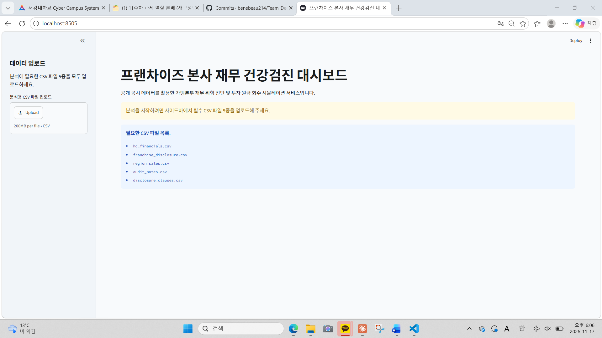

분석 결과 (metric · 차트)

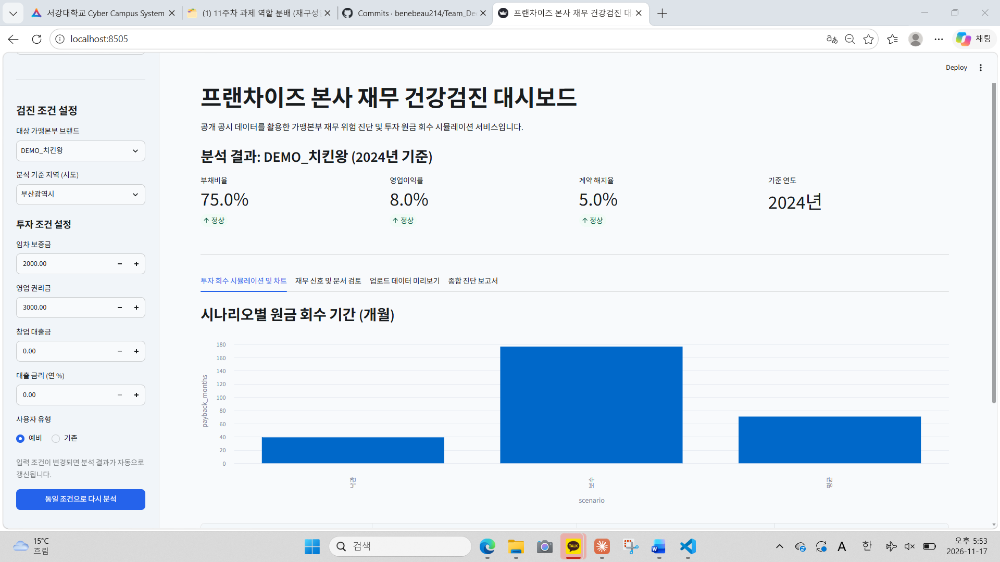

회수 기간 표

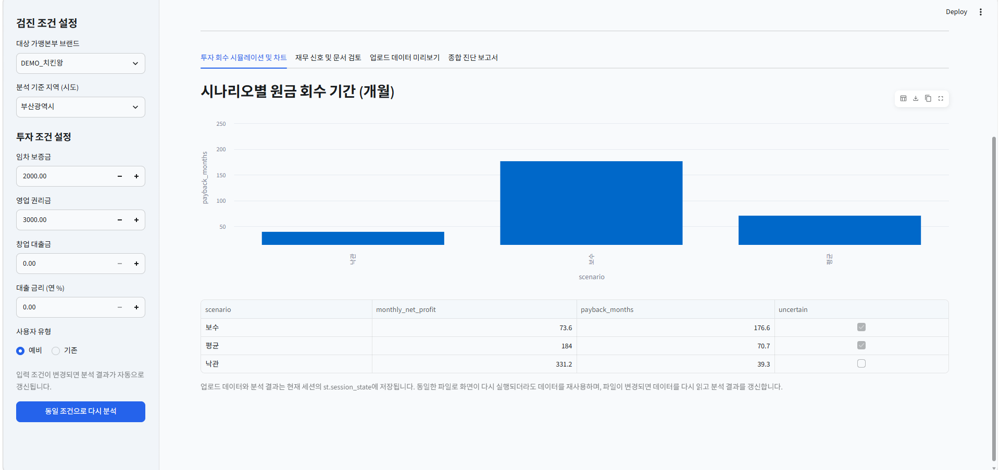

업로드 데이터 미리보기

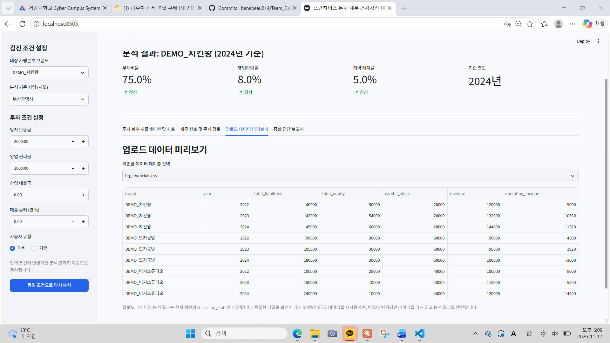

종합 진단 보고서 ([MOCK] 표식)

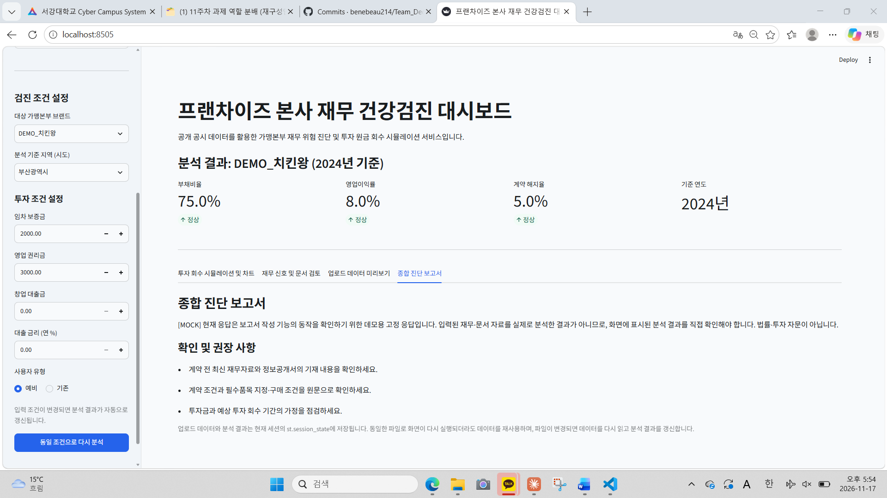

## 시나리오 2. 정상 cp949 CSV (검증: 최영효)

| 항목 | 내용 |
| --- | --- |
| 데이터셋 | `sample_data/cp949_normal/` (시나리오 1과 같은 내용, cp949 저장) |
| 검증 커밋 | `f927c22` (검증 시점의 main, PR #33 머지) |
| 절차 | 1) `cp949_normal/`의 CSV 5종을 업로드한다. 2) 공통 입력값(대출금 0, 금리 0)으로 분석 결과를 확인한다. |
| 예상 결과 | 에러 없이 시나리오 1과 같은 값이 표시된다. 브랜드·지역 선택 상자와 화면의 한글이 깨지지 않는다. |
| 실제 결과 | **통과.** 오류 없이 결과 화면 표시. metric: 부채비율 75.0% · 영업이익률 8.0% · 계약 해지율 5.0% (모두 정상), 기준 연도 2024년 회수 기간: 보수 176.6 / 평균 70.7 / 낙관 39.3개월, 보수·평균 불확실 표시 시나리오 1(백엔드 기준값)과 동일 |
| 캡처 | 아래 "시나리오 2 캡처" 참고 |
| 관찰 내용 | ① 업로드 목록의 파일 크기(0.5~1.5KB)가 cp949 파일 크기와 일치 → cp949 파일로 검증됨을 확인 ② 한글(브랜드명, 지역명, 시나리오명, 탭 이름) 깨짐 없음 ③ (화면 개선 제안) 차트 x축 라벨이 90도로 누워 있음, 막대 순서가 낙관·보수·평균(가나다순), y축 범위가 화면마다 달라짐(-50~200, -100~400) |

#### 시나리오 2 캡처

업로드 목록과 분석 결과 (metric · 차트)

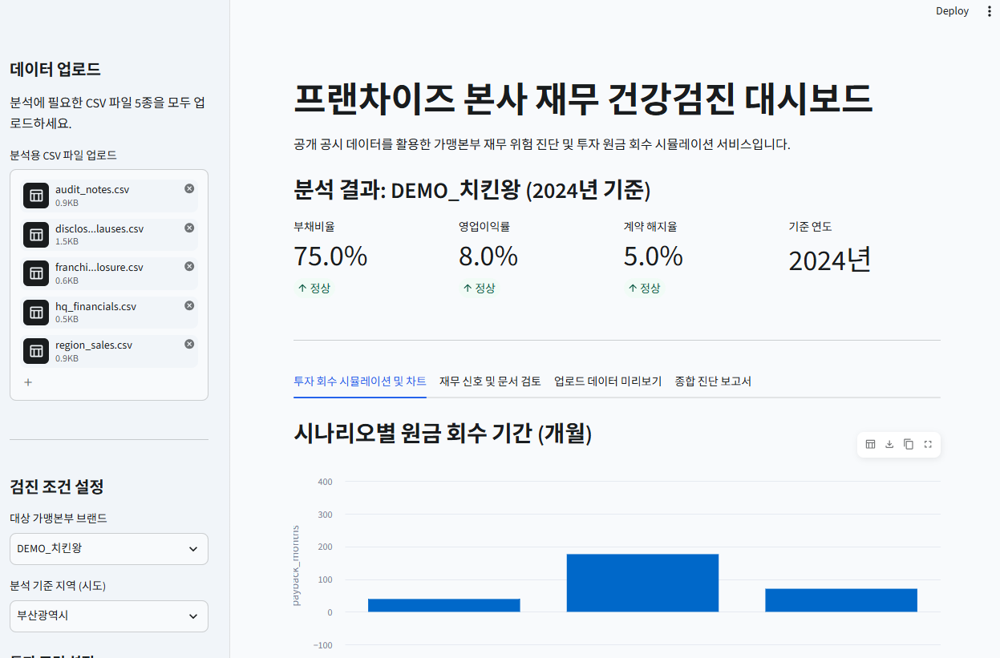

회수 기간 차트와 표

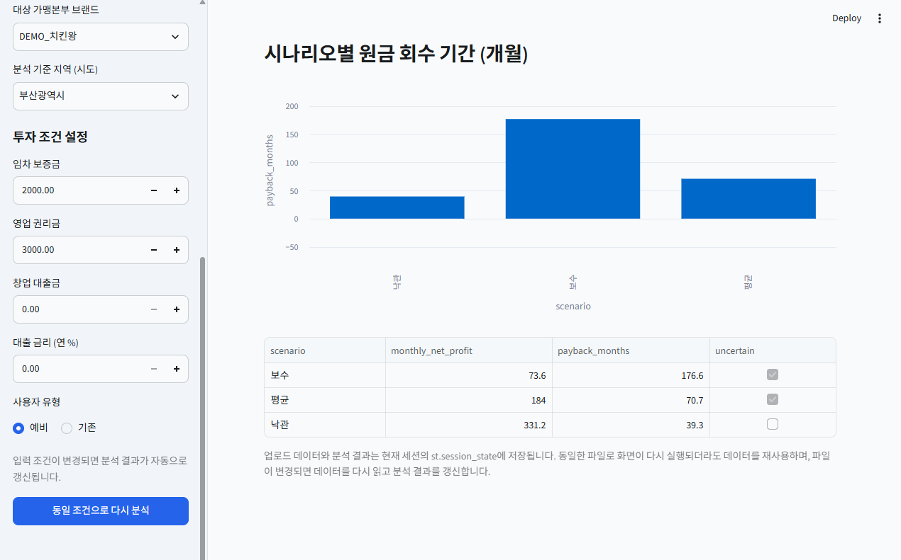

## 시나리오 3. 열이 누락된 CSV (검증: 김리나)

| 항목 | 내용 |
| --- | --- |
| 데이터셋 | `sample_data/missing_column/` (`hq_financials.csv`에서 필수 열 `total_liabilities` 제거) |
| 절차 | `missing_column/`의 CSV 5종을 업로드한다. |
| 예상 결과 | 앱이 종료되지 않고 파일 이름과 빠진 열 이름이 포함된 오류 안내가 나온다 (예: "hq_financials.csv에 필수 열 'total_liabilities'가 없습니다."). 분석 결과 화면은 나오지 않는다. |
| 실제 결과 | **통과.** CSV 5종 업로드 후 빨간 오류 안내 표시: `데이터 적재 오류: hq_financials.csv에 필수 열 'total_liabilities'가 없습니다.` 예상 문구와 일치. 검진 조건 설정(브랜드·지역 선택), metric, 결과 탭은 표시되지 않음. 앱 페이지와 업로드 목록은 그대로 유지됨 |
| 캡처 | 아래 "시나리오 3 캡처" 참고 |
| 관찰 내용 | 오류 메시지가 파일 이름과 열 이름을 모두 알려 주어 사용자가 어떤 파일을 고쳐야 하는지 바로 알 수 있음 |

#### 시나리오 3 캡처

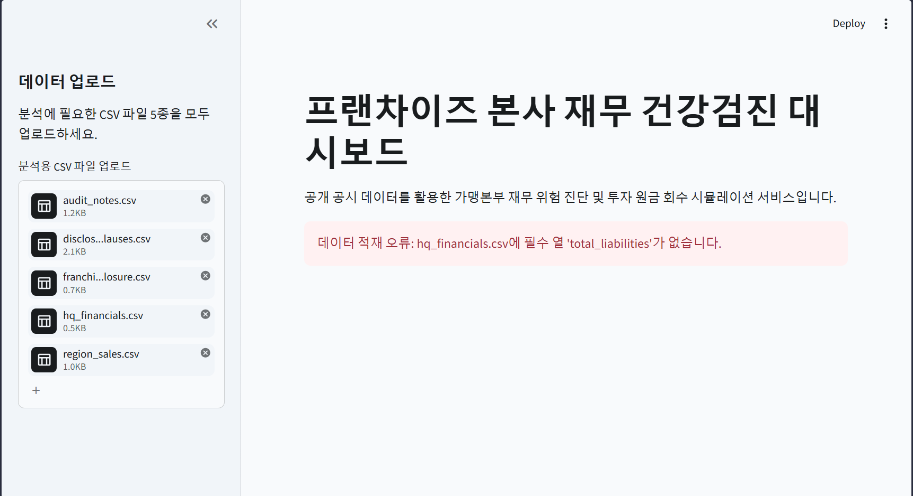

## 시나리오 4. 추가 확인 

| 번호 | 확인 항목 | 절차 | 예상 결과 | 실제 결과 | 캡처 | 관찰 내용 |
| --- | --- | --- | --- | --- | --- | --- |
| 4-a | 사이드바 필터 즉시 반영 (검증: 이혜원) | 정상 데이터 업로드 후 DEMO_도자공방 / 경기도 / 앱 기본 투자 조건(대출금 5000, 금리 5.0)에서 대출 금리만 5.0 → 6.0으로 바꾼다. | 버튼을 누르지 않아도 결과가 바뀐다. | **통과.** 버튼 클릭 없이 회수 기간이 바로 갱신됨. 변경 전: 보수 1,280.1 / 평균 302 / 낙관 149.6개월 변경 후: 보수 1,666.7 / 평균 319.4 / 낙관 153.7개월 | `04_upload_initial.png`, `04_change_condition.png` | 브랜드·지역 선택이 아니라 투자 조건(금리) 변경으로 확인함. 이 브랜드에서는 낙관 시나리오도 uncertain에 체크되어 3개 모두 불확실로 표시됨 |
| 4-b | 파일 교체 시 이전 결과 잔존 여부 (검증: 이혜원) | 4-a 결과 화면에서 업로드 파일을 `missing_column/` 파일 세트로 교체한다. | 이전 분석 결과가 사라지고 오류 안내만 남는다. | **통과.** `데이터 적재 오류: hq_financials.csv에 필수 열 'total_liabilities'가 없습니다.` 표시. 이전 metric·차트·표와 검진 조건 설정이 모두 사라짐 | `04_change_file.png` | 오류 문구가 시나리오 3과 동일 |
| 4-c | 업로드 후 파일 제거 (검증: 오채윤) | 정상 데이터(utf8_normal) 업로드 후 결과 화면에서 업로드 파일 5개를 모두 X로 제거한다. | 업로드 전 안내 화면으로 돌아간다. | **통과.** 필수 파일 5종 안내(경고·목록)가 다시 표시되고, 이전 metric·차트·탭은 남지 않음. 오류 없음 (main `41f271f`) | `04c_remove.png` | `2cb5132`(업로드 해제 시 세션 초기화) 반영 후 버전에서 확인 |
| 4-d | Mock 표식 | 리포트 영역을 확인한다. | `[MOCK]` 표식이 보인다. API 키 없이 끝까지 실행된다. | **통과.** 시나리오 1에서 확인 (검증: 오채윤) | `01_utf8_report.png` | 종합 진단 보고서 첫 문장 앞에 `[MOCK]` 표시 |

#### 추가 확인 캡처

4-a 금리 변경 전 (DEMO_도자공방 / 경기도, 금리 5.0)

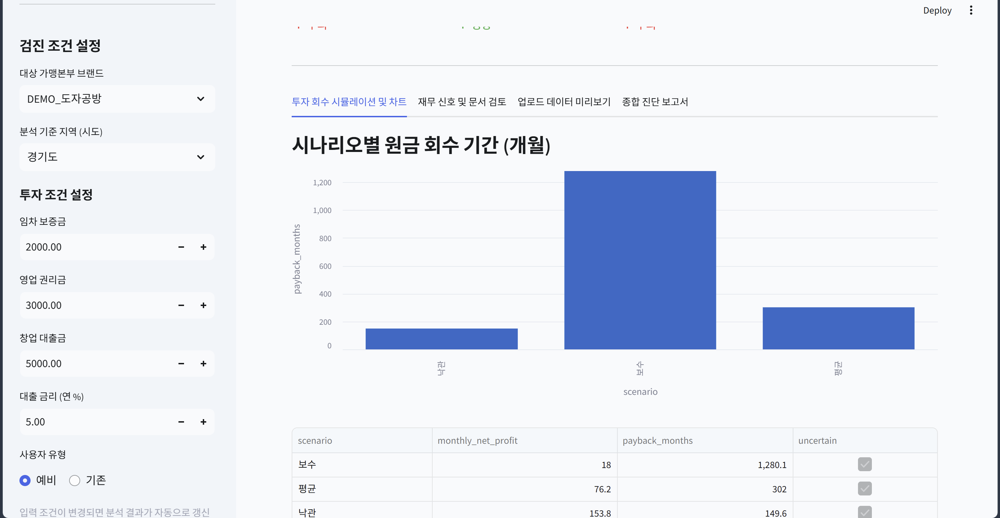

4-a 금리 변경 후 (금리 6.0)

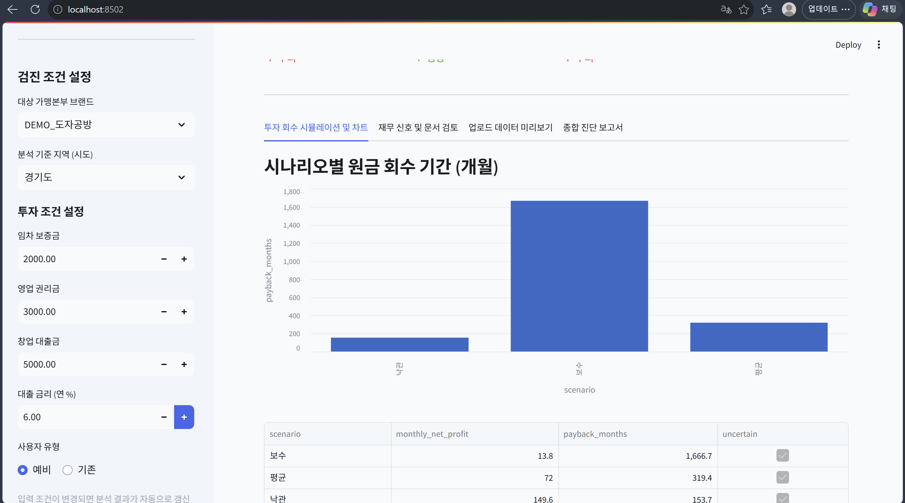

4-b 파일 교체 후 (missing_column 세트)

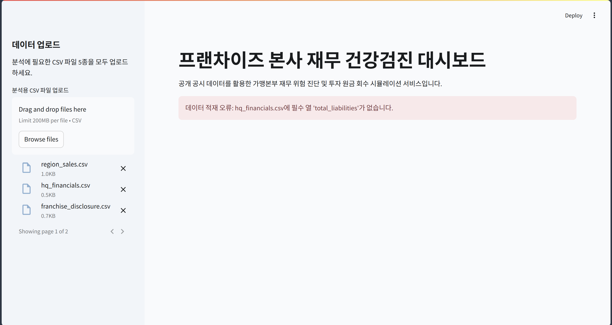

4-c 업로드 파일 모두 제거 후 (main `41f271f`)

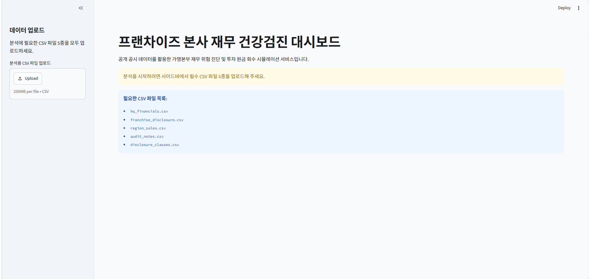

## 발견한 문제와 수정 내역

| 번호 | 발견 시나리오 | 증상 (화면·오류 메시지) | 전달 대상 | 수정내역 |
| --- | --- | --- | --- | --- | 
| 1 | 시나리오 1 | 분석 실행 버튼 없이 입력 변경 때마다 자동 재분석 (역할 분배 문서 3번과 다름. 13주차 실제 API 연결 시 호출 비용·대기 시간 증가 우려) | A (혜원) | 전달함, 12주차 반영 검토 | 
| 2 | 시나리오 1 | metric 등급 표시에 ↑ 화살표가 붙어 값 상승으로 오해될 수 있음 | A (혜원) | 12주차 반영 (U5 `19126a7`: 화살표 제거, 색으로만 구분) | 
| 3 | 시나리오 1 | 차트 x축 라벨 세로 표시, 시나리오 순서(낙관·보수·평균)가 표(보수·평균·낙관)와 다름, 축 제목이 영문 열 이름 | A (혜원) | 12주차 반영 (U7 `f3baede`: 시나리오 순서를 표와 통일, 축 제목 한글화) | 
| 4 | 시나리오 1 | 회수 기간 표 열 이름이 영문, uncertain이 체크박스로만 표시 | A (혜원) | 12주차 반영 (U2 `850e7f7`: 열 이름 한글화, B2 `81f7b34`: uncertain 대신 "회수 판단" 문구 열) | 
| 5 | 코드 확인 | app.py에서 `validate_user_input`을 호출하지 않음 (역할 분배 문서 2번 "입력값 검증 유지"와 다름) | A (혜원) | 전달함, 12주차 반영 검토 | 

## 회귀 확인 (pytest)

- 실행 시점: 2026-11-17, 11주차 PR(#30~#40) 머지 후 main `41f271f`
- 실행 명령: `python -m pytest -v` (`USE_MOCK=true`)
- 실행 환경: Windows 11 Home / Python 3.13.15 / pytest 9.2.0 / streamlit 1.67.0 / pandas 3.1.0
- 결과 파일: `tests/pytest_result_week11.txt`
- 결과: **134 passed, 0 failed** (12.82s)

| 테스트 파일 | 통과 수 |
| --- | --- |
| `tests/test_app.py` | 8 |
| `tests/test_data_loader.py` | 16 |
| `tests/test_llm_client.py` | 13 |
| `tests/test_llm_tasks.py` | 40 |
| `tests/test_payback.py` | 7 |
| `tests/test_pipeline.py` | 3 |
| `tests/test_pipeline_internal.py` | 11 |
| `tests/test_signals.py` | 36 |
| **합계** | **134** |

- 10주차(`tests/pytest_result_week10.txt`, 122 passed) 대비 12개 증가. 기존 테스트 중 실패로 바뀐 것은 없다.
- 업로드 로더(`load_tables_from_uploads`) 테스트 7개가 포함되어 통과했다: UTF-8 정상, CP949 재시도, 필수 파일 누락, 중복 파일, 필수 열 누락, 빈 파일, 잘못된 CSV. 수동 검증 시나리오 1~3과 같은 경우를 자동 테스트로도 확인한 셈이다.
- 참고: 수동 검증(시나리오 1~4)은 `2c658ca` 기준으로 수행했고, 이후 app.py에 리팩터링 2건(`79c161c` 세션 상태 초기화·데이터 캐시 관리 개선, `2cb5132` 업로드 해제 시 세션 초기화·입력 UI 개선)이 머지되었다. 이 변경은 위 pytest(`test_app.py` 포함)로 회귀를 확인했다.

---

# 12주차 오입력 검증 (배포본, 검증: 최영효)

- 검증 일자: 2026-11-24
- 검증 대상: 배포 앱 (https://teamdecoders-jejavchdn3bbqbfmeazh7y.streamlit.app/), main `4a084a5` 재배포 후
  - 재배포 확인: 정상 데이터 업로드 시 metric 판정 문구에 화살표가 없음 (U5 `19126a7` 반영 상태)
- 목적: 12주차 피드백 반영(B3 중복 업로드 안내, U10 오류 시 5종 목록 유지·다음 행동 안내)이 배포본에서 동작하는지, 오입력 시 안내 메시지가 2곳 이상 동작하는지 확인
- 공통 절차: 매 시나리오 전에 업로드 파일을 모두 제거(X)한 뒤 시작

| 번호 | 오입력 유형 | 올린 파일 | 예상 결과 | 실제 결과 | 확인한 수정 |
| --- | --- | --- | --- | --- | --- |
| 12-1 | 필수 파일 누락 | `utf8_normal/`에서 `region_sales.csv`를 뺀 4개 | 빠진 파일명과 추가 업로드 안내가 나오고, 필수 CSV 5종 목록이 사라지지 않는다. 분석은 실행되지 않는다. | **통과.** `데이터 적재 오류: 필수 파일이 누락되었습니다: region_sales.csv region_sales.csv를 추가로 업로드해 주세요.` 표시. 아래에 필수 CSV 5종 목록 유지. 앱 종료 없음 | U10 |
| 12-2 | 필수 열 누락 | `missing_column/` 5개 (`hq_financials.csv`에 `total_liabilities` 없음) | 파일명·열 이름이 포함된 오류와 확인 후 재업로드 안내가 나오고, 5종 목록이 유지된다. | **통과.** `데이터 적재 오류: hq_financials.csv에 필수 열 'total_liabilities'가 없습니다. 해당 CSV의 내용을 확인한 뒤 다시 업로드해 주세요.` 표시. 5종 목록 유지. 앱 종료 없음 | U10 (11주차 시나리오 3에는 없던 다음 행동 안내가 추가됨) |
| 12-3 | 중복 업로드 | `utf8_normal/` 5개 + `cp949_normal/` 5개 (같은 이름 10개) | 중복된 파일명 5개가 한 번에 모두 표시된다. | **통과.** `데이터 적재 오류: audit_notes.csv, disclosure_clauses.csv, franchise_disclosure.csv, hq_financials.csv, region_sales.csv 파일이 중복 업로드되었습니다. 중복된 파일은 하나씩만 남겨 주세요.` 표시. 5종 목록 유지 | B3 |

결론: 오입력 3종 모두 `st.error` 안내가 표시되고 앱이 종료되지 않았다. 12주차 제출 요건(오입력 안내 2곳 이상 동작)을 충족한다.

#### 12주차 오입력 검증 캡처

12-1 필수 파일 누락

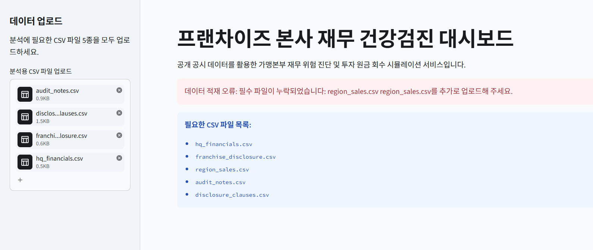

12-2 필수 열 누락

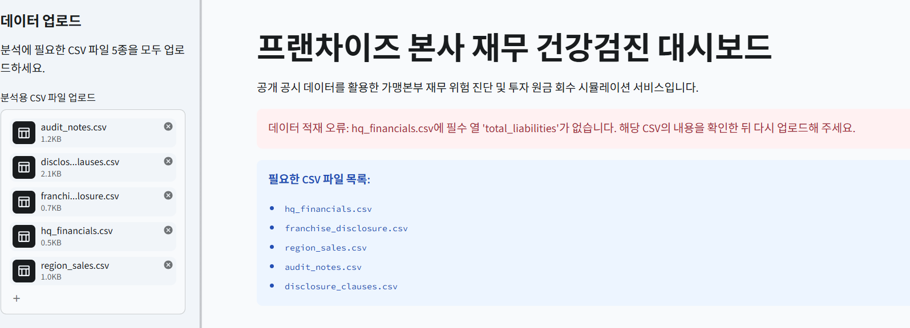

12-3 중복 업로드

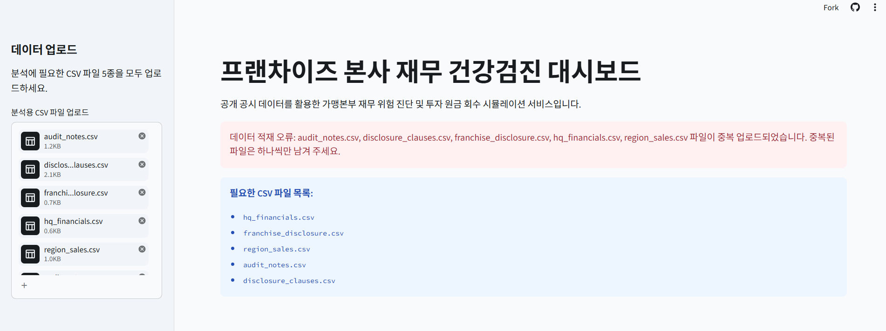

#### 12주차 검증 중 발견한 문제

| 번호 | 발견 시나리오 | 증상 | 원인 | 전달 대상 | 상태 |
| --- | --- | --- | --- | --- | --- |
| 1 | 12-1 | 오류 문구에 누락 파일명이 두 번 연달아 나옴 (`...누락되었습니다: region_sales.csv region_sales.csv를 추가로 업로드해 주세요.`) | `data_loader.py`의 오류 문구에 이미 파일명이 들어 있는데, `app.py`(216줄)가 같은 파일명을 다시 붙임. 두 문장 사이에 마침표도 없음 | 채희 | 전달함 (동작에는 문제없는 문구 오류) |
